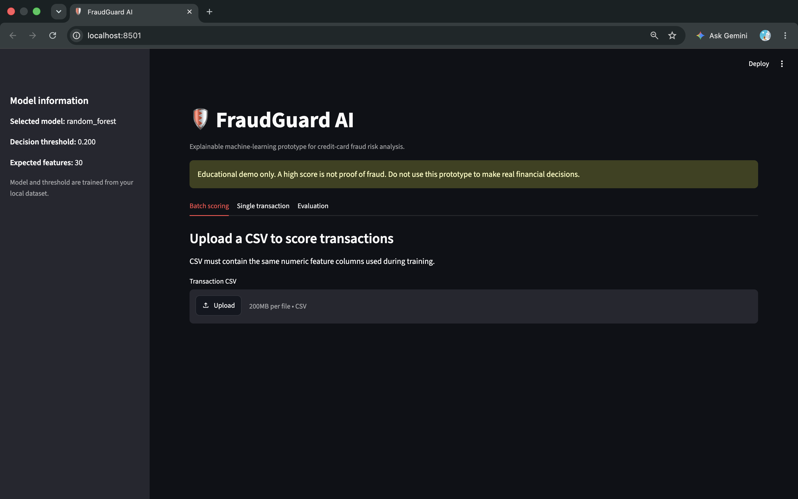
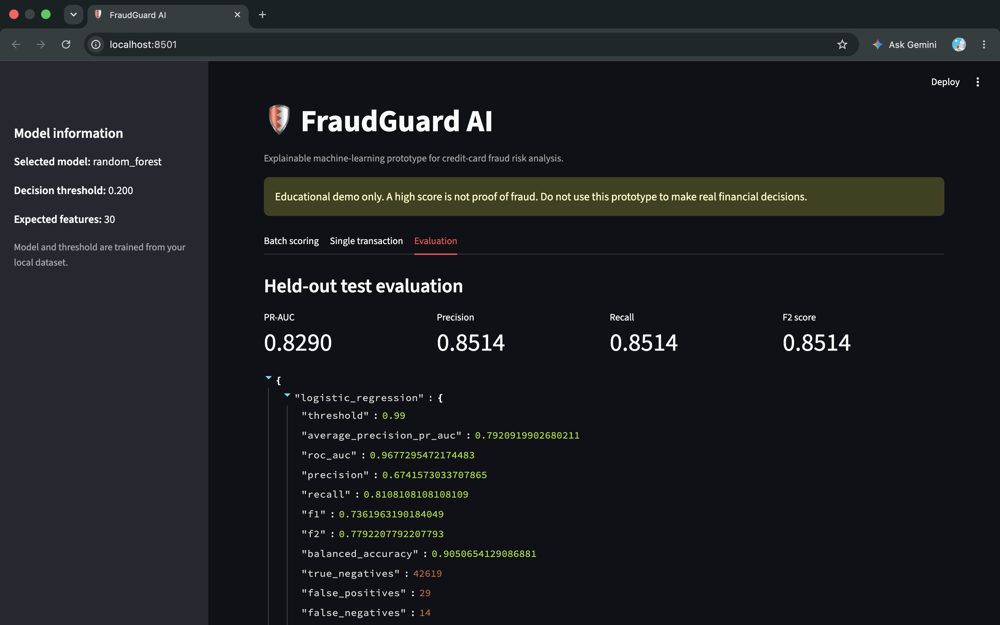
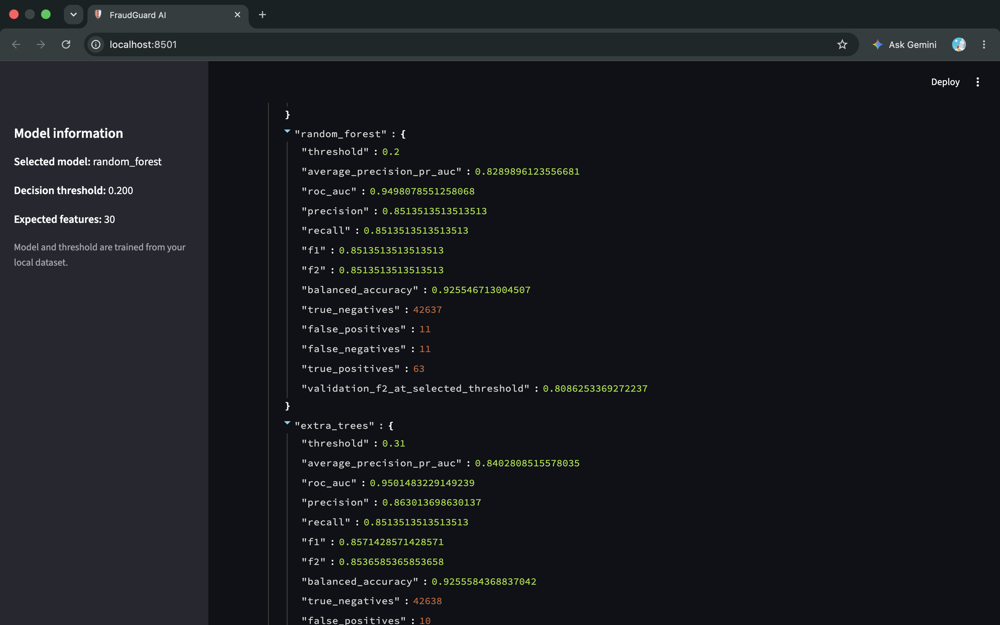
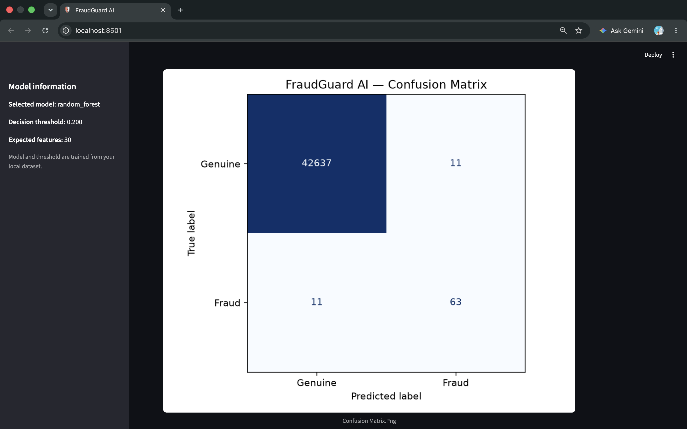
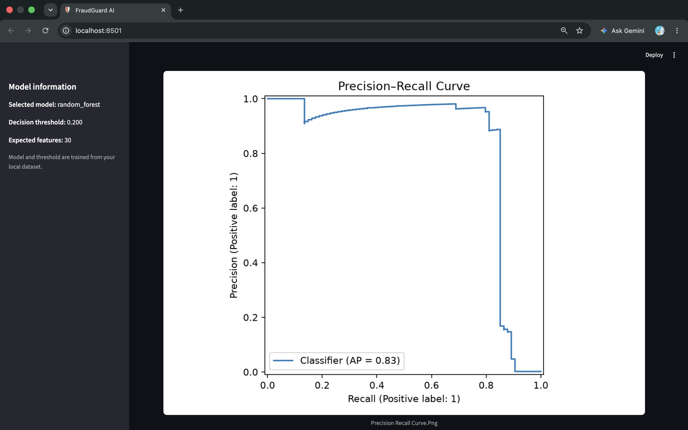
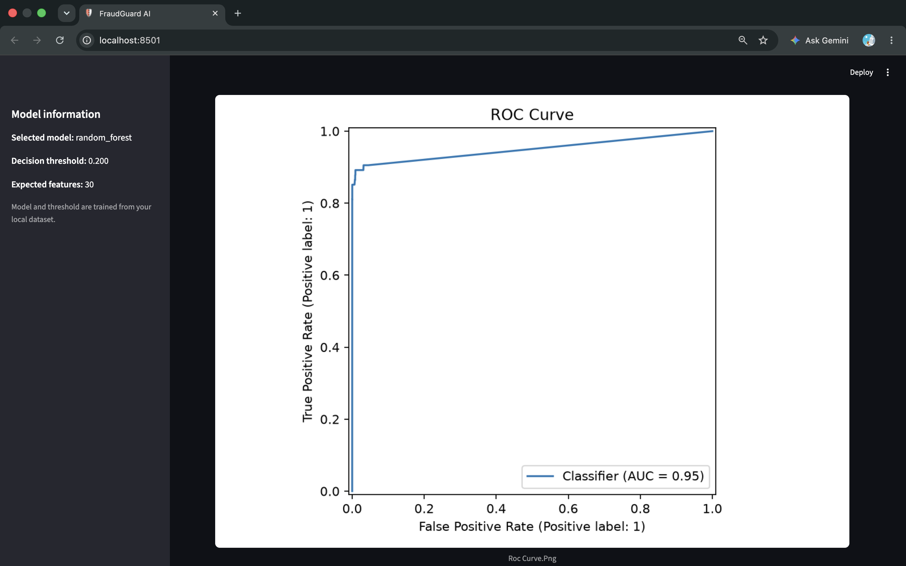
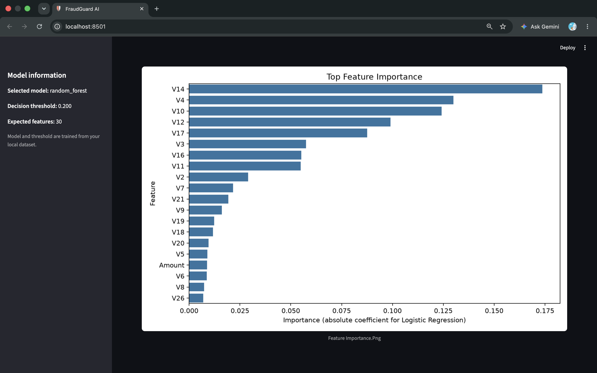
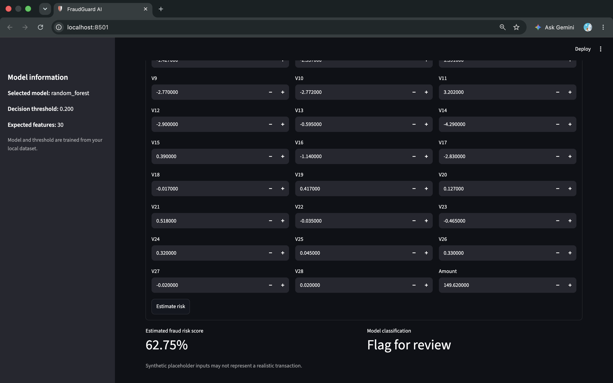

# 🛡️ FraudGuard AI

An end-to-end Python machine-learning project for educational credit-card fraud risk analysis. It trains and compares multiple models, selects a decision threshold using validation data, evaluates on a held-out test set, generates plots, scores CSV files, and provides a Streamlit interface.

> **Responsible-use note:** This is a portfolio prototype, not a production payment-security system. A model score is not proof of fraud. Do not use it to automatically accuse customers, deny service, or block real transactions.

## Features

- Dataset schema and target validation
- Stratified train/validation/test split
- Logistic Regression, Random Forest, and Extra Trees
- Class imbalance handling through class weights
- Validation-only threshold selection using F2
- PR-AUC, ROC-AUC, precision, recall, F1, F2, balanced accuracy
- Confusion matrix, precision-recall curve, ROC curve, feature importance
- Batch CSV scoring with risk scores and risk bands
- Streamlit dashboard
- Automated tests with pytest

## Dataset

Use the public **Credit Card Fraud Detection** dataset from Kaggle:
https://www.kaggle.com/datasets/mlg-ulb/creditcardfraud

An alternative host is Zenodo:
https://zenodo.org/records/7395559

The dataset has 284,807 transactions and 492 frauds. The `V1`–`V28` columns are PCA-transformed variables; `Time` and `Amount` are also provided. Check the source's current license and terms before redistribution. Do not commit the CSV to GitHub.

Download `creditcard.csv` and put it at:

```text
data/raw/creditcard.csv
```

## Setup on macOS

Python 3.11 is recommended. Check with `python3 --version`.

```bash
git clone https://github.com/YOUR-USERNAME/fraudguard-ai.git
cd fraudguard-ai

python3 -m venv .venv
source .venv/bin/activate
python -m pip install --upgrade pip
pip install -r requirements.txt
pip install -e .
```

For local development before publishing, run those commands inside the project directory without `git clone`.

## Install the package in editable mode

```bash
pip install -e .
```

## Train and evaluate

```bash
python -m fraudguard.train --data data/raw/creditcard.csv
```

Generated files:

```text
artifacts/fraudguard_model.joblib
reports/metrics.json
reports/model_comparison.csv
reports/figures/confusion_matrix.png
reports/figures/precision_recall_curve.png
reports/figures/roc_curve.png
reports/figures/feature_importance.png
```

Model selection is based on validation F2, not test performance. The test set is used for the final evaluation report. Results depend on the dataset, random split, installed library versions, and model settings; no metric is promised in advance.

## Run the dashboard

```bash
streamlit run app.py
```

Streamlit prints a local URL, usually `http://localhost:8501`.

## Score a new CSV

The input CSV must contain the same numeric feature columns used during training (`Time`, `V1`–`V28`, `Amount`). It may optionally include `Class`, which is ignored for scoring.

```bash
python -m fraudguard.predict \
  --input data/sample_transactions.csv \
  --output reports/predictions.csv
```

Never use real card numbers or personal financial information in a demo. This dataset uses anonymized features.

## Tests

```bash
pytest -q
```

## GitHub publishing checklist

1. Review `git status`.
2. Confirm `data/raw/creditcard.csv`, model artifacts, and personal data are ignored.
3. Add a screenshot of the dashboard and generated evaluation charts to the README if desired.
4. Create a public GitHub repository named `fraudguard-ai`.
5. Push your source code:

```bash
git init
git add .
git commit -m "Build FraudGuard AI fraud detection pipeline"
git branch -M main
git remote add origin https://github.com/YOUR-USERNAME/fraudguard-ai.git
git push -u origin main
```

If Git reports that the remote already has commits, inspect the remote before pushing. Do not force-push blindly.

## Project structure

```text
fraudguard-ai/
├── app.py
├── requirements.txt
├── pyproject.toml
├── README.md
├── .gitignore
├── data/
│   └── raw/
├── artifacts/
├── reports/
│   └── figures/
├── src/
│   └── fraudguard/
│       ├── __init__.py
│       ├── data.py
│       ├── metrics.py
│       ├── plots.py
│       ├── train.py
│       └── predict.py
└── tests/
    ├── test_data.py
    └── test_metrics.py
```

## Limitations and next steps

- Public historical data may not reflect current fraud behavior.
- PCA-transformed features are difficult to interpret in business terms.
- Threshold choice should reflect operational costs and review capacity.
- Scores are not guaranteed to be calibrated probabilities.
- Production deployment would need monitoring, drift detection, security controls, audit logs, privacy review, and human oversight.
- Future improvements: time-aware evaluation, calibration, SHAP explanations, API serving, CI with GitHub Actions, and model drift monitoring.

## References

- Dataset: https://www.kaggle.com/datasets/mlg-ulb/creditcardfraud
- scikit-learn model evaluation: https://scikit-learn.org/stable/modules/model_evaluation.html
- imbalanced-learn: https://imbalanced-learn.org/
- Streamlit documentation: https://docs.streamlit.io/


## Dashboard Screenshots

### Dashboard Overview


### Model Evaluation














### Fraud Prediction


